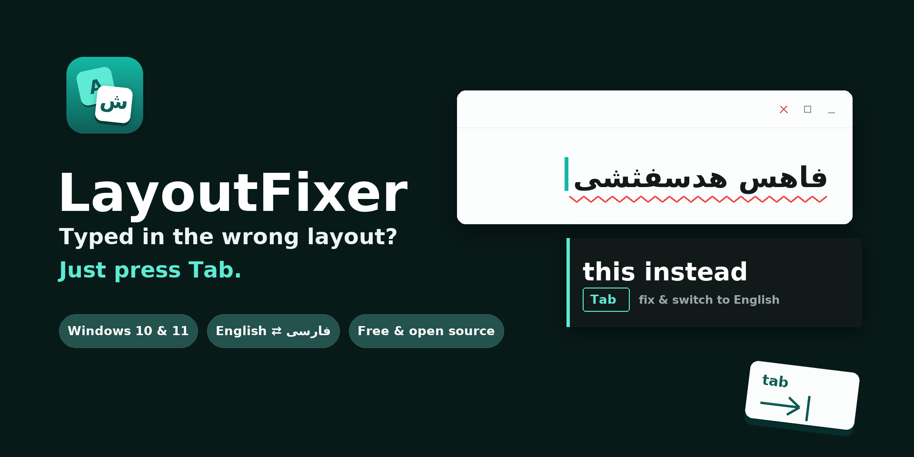

<p align="center">
  
</p>

<p align="center">
  Typed a whole sentence with the wrong keyboard layout? Press <kbd>Tab</kbd>.<br>
  A tiny Windows tray app that fixes English ⇄ Persian layout mistakes as you type.
</p>

<p align="center">
  <a href="https://github.com/sina-developer/LayoutFixer/releases/latest"><b>Download for Windows</b></a>
</p>

## See it in action

You meant to write:

```
want to grab lunch today
```

but the keyboard was still on Persian, so you got:

```
صشدف فخ لقشذ معدزا
```

LayoutFixer notices, shows a small popup under your caret, and when you press <kbd>Tab</kbd> it
retypes the text in the right language **and switches your keyboard layout** for you. It works the
other way too: `sghl` → `سلام`.

No installation of a runtime, no administrator rights, no permission dialogs: you unzip one
`LayoutFixer.exe`, run it, and it is in the tray next to the clock.

## Features

- Works in every app: browsers, chat apps, editors, mail, terminals.
- Asks before changing anything. <kbd>Tab</kbd> fixes it, <kbd>Esc</kbd> (or just keep typing) ignores it.
- Fixes the whole run of wrong words, not just the last one.
- Switches the active input language (the same thing <kbd>Win</kbd>+<kbd>Space</kbd> does), so the
  next words come out right.
- Reads your real keyboard layout instead of a hardcoded table: keys are translated through the
  layout Windows is actually using (Persian, Persian (Standard), US, UK, a phonetic third-party
  layout — whatever you added), so the mapping is never wrong for your keyboard.
- Nothing to allow first: unlike the macOS version, Windows asks for no Accessibility permission.
- Fully offline. Nothing is stored, logged or sent anywhere, and the app makes no network requests.

## Install

You need Windows 10 or 11, and both an English and a Persian keyboard added in
**Settings → Time & language → Language & region**.

### Download

1. Download `LayoutFixer-x.y.z-win-x64.zip` from the
   [latest release](https://github.com/sina-developer/LayoutFixer/releases/latest) and unzip it
   somewhere permanent — not inside a temp folder. On Windows on Arm, take the `win-arm64` zip.
2. Double-click `LayoutFixer.exe`. Windows may warn that the app is not from the Store: choose
   **More info → Run anyway** (the build is not Authenticode-signed yet).
3. It sits in the notification area. Double-click the icon to pause and resume; right-click it for
   **Enabled**, **Start with Windows** and **Quit**.

There is no installer and no service. The exe writes nothing to your files and, unless you tick
**Start with Windows**, nothing to the registry either.

### Build from source

```powershell
git clone https://github.com/sina-developer/LayoutFixer.git
cd LayoutFixer
.\scripts\build.ps1
build\publish-win-x64\LayoutFixer.exe
```

Only the [.NET 8 SDK](https://dotnet.microsoft.com/download/dotnet/8.0) is needed
(`winget install Microsoft.DotNet.SDK.8`). Visual Studio is not: the app has no designer files, no
NuGet dependencies and no project other than `Sources/LayoutFixer/LayoutFixer.csproj`.

The build options are in the header of [`scripts/build.ps1`](scripts/build.ps1):
`-Arch arm64` for Windows on Arm, `-FrameworkDependent` for a small build that needs the
*.NET 8 Desktop Runtime* installed, `-Zip` to also produce the release zip, `-Test` to print what
the detector makes of a sample after building.

To regenerate the icons or the cover above (optional, Python + Pillow only):

```powershell
.\scripts\make-icons.ps1
python icon\make_cover.py
```

## How it works

LayoutFixer only suggests a fix when the other reading is a **real word**:

| You're typing on… | It flags a word when… | Suggests |
|---|---|---|
| Persian layout | the same keys spell a common English word (`صشدف` → `want`) | English |
| English layout | it isn't an English word **and** the same keys spell a real Persian word (`sghl` → `سلام`) | Persian |

So names, brands and typos (`github`, `figma`, `teh`) are never touched: their Persian reading is
gibberish.

Details:

- Words are checked when you press <kbd>Space</kbd>.
- 2-letter words are ambiguous (the Persian word `شد` is `an` on English keys), so they're only
  included when the word next to them is clearly wrong too.
- The physical keys are recorded as scan codes — what the keyboard actually sent — and translated
  through the other layout with `ToUnicodeEx`, so the conversion is exact for whatever layouts you
  use. The corrected text is typed back as Unicode events, which is why it cannot come out in the
  wrong layout again.
- The word lists are 50k-word English and Persian frequency lists, embedded in the exe.
- Windows has no `/usr/share/dict/words` to lean on, so rare English words are covered by a file you
  own: put them one per line in `%LOCALAPPDATA%\LayoutFixer\words.txt` and they join the "this is
  real English, leave it alone" set. Names, brands, jargon. The app only reads that file.

Known limits:

- The popup is placed at the text caret through `GetGUIThreadInfo`. Apps that don't report a caret
  (most Electron and Chromium windows, until you click into a field) get it at the mouse pointer instead.
- A window that runs **as administrator** cannot be watched or typed into by a normal LayoutFixer;
  that is Windows, not the app. Start LayoutFixer from an elevated terminal if you need it there.
- Secure screens (the lock screen, UAC prompts) are closed to keyboard hooks of any ordinary app, so
  LayoutFixer is simply not running there.
- Only the `en`/`fa` language pair is watched; other layouts (Arabic, Russian, Hebrew) are on the
  ideas list below.
- If both **Persian** and **Persian (Standard)** are enabled, one of them is used to translate the
  keys: Windows gives two variants of one language the same handle. Their letters are identical —
  only the punctuation and the digit row differ, and those never end up inside a word.

## Privacy

This is a keyboard monitor, so here is exactly what it does:

- It keeps only the last few words you typed, in memory, to check them and retype them.
- The buffer is cleared when you click, use arrow keys, use shortcuts, or switch windows.
- If the box being typed into is a classic Windows password field (a masked edit control), the
  keystrokes are dropped instead of remembered. Masked fields in browsers are drawn by the browser
  itself, so those cannot be recognised — and nothing is kept longer than a few words there either.
- Nothing is written to disk, logged, or sent over the network. The app makes no network requests.

Everything is in `Sources/LayoutFixer/`, about 1.5k lines of C# in seven files:

```
Sources/LayoutFixer/
  Program.cs            entry, tray icon and menu, startup toggle, --test mode
  Fixer.cs              what is a word, what looks wrong, when to ask, what to type back
  KeyboardLayouts.cs    HKLs, key -> character through either layout, switching the layout
  Dictionaries.cs       the frequency lists, normalization, the "is this a mistake" decision
  Popup.cs              the borderless window under the caret
  InputHooks.cs         the low-level keyboard/mouse hooks, the SendInput batch that retypes
  Native.cs             the Win32 declarations, nothing else
```

## Testing the detector without the app running

```powershell
.\build\publish-win-x64\LayoutFixer.exe --test "صشدف فخ لقشذ معدزا"
# layouts: en=04090409, fa=04290429
# words: english=49267 persian=39683
# صشدف -> want  FIX
# فخ -> to  fix-if-next-is-wrong
# لقشذ -> grab  FIX
# معدزا -> lunch  FIX
```

`فخ` is `to` — two letters, so it is only fixed as part of a run that is already wrong. That is the
`fix-if-next-is-wrong` line, and it is the same rule the table above describes.

`--test` reads the same dictionaries and the same layout tables the app uses, and changes nothing.
On a machine with no Persian keyboard added it falls back to the stock layout tables, which is why
this also runs in CI (see [`.github/workflows/build.yml`](.github/workflows/build.yml)).

## Ideas and pull requests

- More language pairs (Arabic, Russian, Ukrainian, Hebrew, Greek — the detection is already generic)
- A settings window (fix without asking, per-app exclusions, your own word lists per direction)
- Learning from words you dismiss
- An MSIX or Inno Setup installer, and an Authenticode-signed release
- Layouts whose letters need a dead key (French, Portuguese), where the current scan-code reading is
  approximate

## Credits

- English and Persian word frequencies: [FrequencyWords](https://github.com/hermitdave/FrequencyWords) by
  Hermit Dave, licensed under [CC BY-SA 4.0](https://creativecommons.org/licenses/by-sa/4.0/).
  See [THIRD_PARTY_NOTICES.md](THIRD_PARTY_NOTICES.md).
- Icons and the cover are drawn by [`icon/make_icon.py`](icon/make_icon.py) and
  [`icon/make_cover.py`](icon/make_cover.py) — the same "stacked keys" picture the macOS version used.

## License

[MIT](LICENSE)
